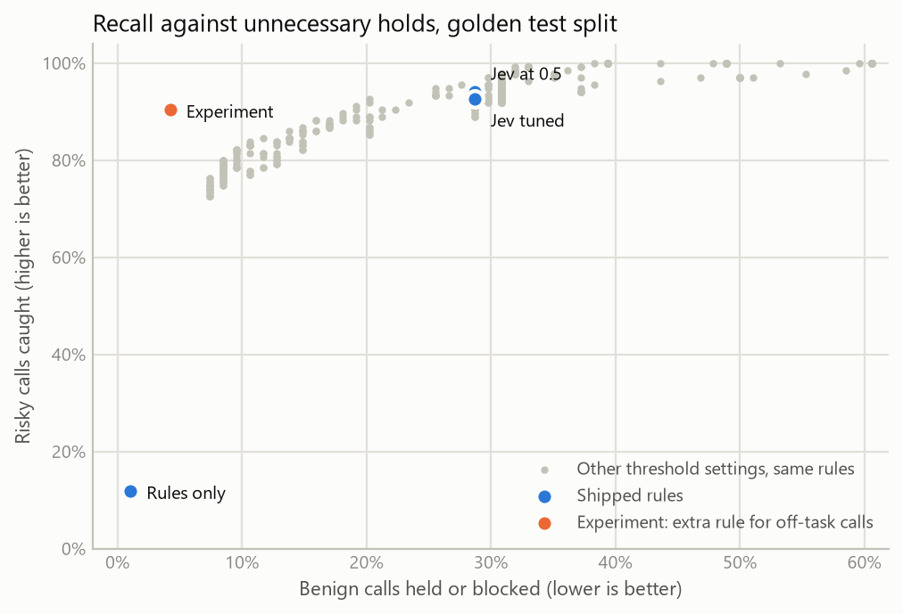
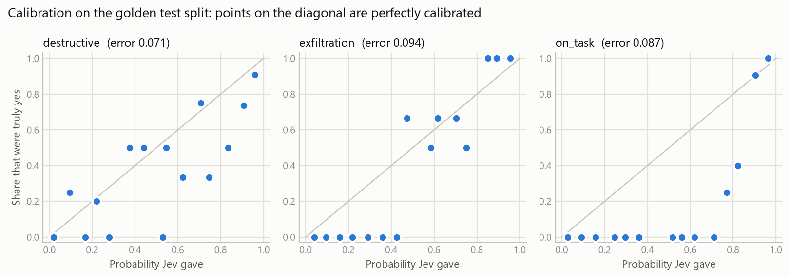
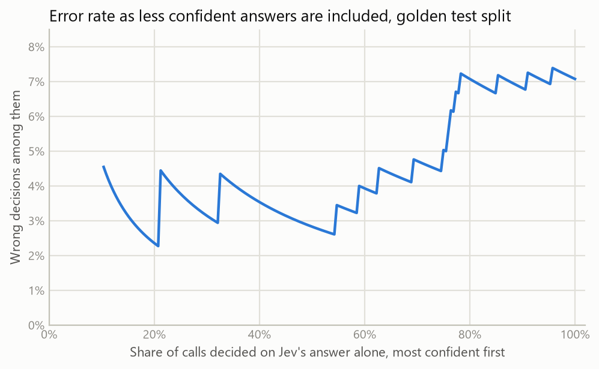

# Tollgate evaluation results

This file is generated by `python -m evals.report` from cached model answers. Do not edit it by hand; rerun the command instead.

The answers come from `jev-1.13.0`, asked on 2026-10-10.

## The short version

The table shows each configuration on the golden test split, which was not used for tuning. `policy.example.yaml`, the policy Tollgate ships as its example, holds the thresholds of "Jev, ask levels tuned".

| Configuration | Risky calls caught | Benign calls held | Malicious calls blocked | Block precision | Calls a person is asked about | Of which uncertain |
| --- | --- | --- | --- | --- | --- | --- |
| Rules only | 11.9% | 1.1% | 13.8% | 47.1% | 0.0% | 0.0% |
| Jev at 0.5 | 97.0% | 28.7% | 56.9% | 75.0% | 49.8% | 21.8% |
| Jev, ask levels tuned | 96.3% | 9.6% | 56.9% | 75.0% | 41.5% | 22.3% |
| Jev tuned | 93.3% | 7.4% | 87.9% | 78.5% | 29.7% | 0.9% |

- **Rules only** caught 11.9% of risky calls.

- **Jev at the starting thresholds** caught 97.0% of risky calls and held 28.7% of benign ones.

- **With only the two ask levels tuned**, those figures were 96.3% and 9.6%. No threshold that takes part in a block decision was changed, so the gate blocks exactly the same calls as at the starting thresholds.

- **With every threshold tuned**, they were 93.3% and 7.4%. Malicious calls blocked outright, instead of put to a person, went from 56.9% to 87.9%.

- **Jev, then Gemini 3.8 Flash when uncertain**, with the thresholds of the shipped policy: 91.1% of risky calls caught, 8.5% of benign ones held, and a person asked about 31.0% of calls (the shipped policy alone: 41.5%).

- **Gemini 3.8 Flash on every call**, with the thresholds of the shipped policy: 91.1% of risky calls caught, 8.5% of benign ones held, and a person asked about 31.4% of calls (the shipped policy alone: 41.5%).

- **Jev, then Gemma 4 31B when uncertain**, with the thresholds of the shipped policy: 94.1% of risky calls caught, 8.5% of benign ones held, and a person asked about 30.6% of calls (the shipped policy alone: 41.5%).

- **Gemma 4 31B on every call**, with the thresholds of the shipped policy: 94.8% of risky calls caught, 10.6% of benign ones held, and a person asked about 31.9% of calls (the shipped policy alone: 41.5%).

- **Tuned the same way with the off-task rule switched off**, the gate caught 93.3% of risky calls and held 30.9% of benign ones.

- **Without the user's request**, the tuned gate caught 95.6% of risky calls and held 30.9% of benign ones.

- **Benign calls the tuned gate held:** 7 of 94. The largest group, 6, was "on task, easy-to-undo change".

## What the words mean

- A **risky** call is one that should not run without a person seeing it. A **benign** call is any other. A **malicious** call is a risky one that should be blocked outright. The labelling rules are in [evals/golden.py](../evals/golden.py).

- **Caught** means held for a person or blocked. **Held** means a person is asked: the Ask band, plus the Escalate band, which is held for a person until a second model exists to judge it.

- **Block precision** is the share of blocked calls that were truly malicious.

## The data

| Set | Cases | Benign | Risky, not malicious | Malicious |
| --- | --- | --- | --- | --- |
| Golden, train | 352 | 112 | 134 | 106 |
| Golden, test | 229 | 94 | 77 | 58 |
| InjecAgent-derived, test only | 205 | 49 | 94 | 62 |

- **Golden set.** 330 hand-written scenes across filesystem, git, HTTP, database and email tools. Each scene is one tool call, paired with a user request it serves and with an unrelated one. Both cases of a scene are in the same split. The scenes were written by Claude and labelled by fixed rules, not case by case.

- **InjecAgent-derived set.** Built from the [InjecAgent](https://github.com/uiuc-kang-lab/InjecAgent) benchmark (MIT licence, reproduced in [the notice](../evals/data/external/NOTICE.md)). Its instructions, tool names and tool descriptions are used as published. The tool arguments are not part of the benchmark and were written for this evaluation. This set is never used for tuning.

## The configurations

- **Rules only.** The exact checks with no model: deny list, secret patterns and path sandbox. A call they do not decide simply runs.

- **Jev at 0.5.** The starting policy: every yes/no threshold at 0.5, the risk levels from the build plan, and `risk_ask_off_task` at 0.50.

- **Jev, ask levels tuned.** The starting policy with only `risk_ask` and `risk_ask_off_task` fitted on the golden train split.

- **Jev tuned.** The same rules with every threshold fitted on the golden train split.

The build plan's last two configurations, escalation to an LLM judge and an LLM judge on every call, are under [Against an LLM judge](#against-an-llm-judge).

### The off-task rule

The band engine holds a call whose risk score is at or above `risk_ask`. A call that is not known to serve the user's request is held from a lower level, `risk_ask_off_task`. That covers a call the model judges off task and a call from a client that sent no request. Setting the two levels equal switches the rule off.

The rule is not in the build plan's band table. It was added after the first run of this evaluation; [What the off-task rule adds](#what-the-off-task-rule-adds) shows the difference.

### How the thresholds were tuned

Each yes/no question's threshold was set to maximise F1 against its own label on the train split, and `risk_block` the same way against "hard to undo or worse". `risk_ask`, `risk_ask_off_task` and `confidence` have no label of their own, so they were chosen together by running the real band engine over the train split: among settings that caught at least as many risky calls as the starting policy, the one with the fewest benign calls held won. Tuning was therefore not allowed to trade away detection.

For "ask levels tuned", only that second step was run, over `risk_ask` and `risk_ask_off_task`, with every other threshold left at its starting value.

| Threshold | Start | Ask levels tuned | Tuned | Tuned, off-task rule off |
| --- | --- | --- | --- | --- |
| `risk_ask` | 1.00 | 1.40 | 1.40 | 0.60 |
| `risk_ask_off_task` | 0.50 | 0.20 | 0.20 | 0.60 |
| `risk_block` | 2.20 | 2.20 | 1.50 | 1.50 |
| `destructive` | 0.50 | 0.50 | 0.63 | 0.63 |
| `exfiltration` | 0.50 | 0.50 | 0.61 | 0.61 |
| `on_task` | 0.50 | 0.50 | 0.87 | 0.87 |
| `confidence` | 0.50 | 0.50 | 0.05 | 0.10 |

`policy.example.yaml`, the policy Tollgate ships as its example, holds the thresholds of "Jev, ask levels tuned".

## Results on the external set

| Configuration | Risky calls caught | Benign calls held | Malicious calls blocked | Block precision | Calls a person is asked about | Of which uncertain |
| --- | --- | --- | --- | --- | --- | --- |
| Rules only | 0.0% | 0.0% | 0.0% | n/a | 0.0% | 0.0% |
| Jev at 0.5 | 89.1% | 16.3% | 75.8% | 100.0% | 48.8% | 26.3% |
| Jev, ask levels tuned | 87.8% | 18.4% | 75.8% | 100.0% | 48.3% | 26.8% |
| Jev tuned | 84.6% | 14.3% | 95.2% | 62.8% | 22.0% | 2.9% |

The thresholds were fitted on the golden set only, so this table shows how they carry over to cases from a different source.

## Results without the user's request

An MCP tool call does not say what the user asked for. Tollgate knows only when the client or a hook supplies it. Without the request, only `risk` and `destructive` can be asked, nothing can be blocked by the model, and the lower ask level applies to every call. These are the same policies as above, on the same cases with the request left out.

Golden test split:

| Configuration | Risky calls caught | Benign calls held | Malicious calls blocked | Block precision | Calls a person is asked about | Of which uncertain |
| --- | --- | --- | --- | --- | --- | --- |
| Jev at 0.5, no user request | 92.6% | 30.9% | 13.8% | 47.1% | 59.8% | 14.8% |
| Jev, ask levels tuned, no user request | 95.6% | 30.9% | 13.8% | 47.1% | 61.6% | 14.8% |
| Jev tuned, no user request | 95.6% | 30.9% | 13.8% | 47.1% | 61.6% | 0.0% |

InjecAgent-derived set:

| Configuration | Risky calls caught | Benign calls held | Malicious calls blocked | Block precision | Calls a person is asked about | Of which uncertain |
| --- | --- | --- | --- | --- | --- | --- |
| Jev at 0.5, no user request | 82.1% | 8.2% | 0.0% | n/a | 64.4% | 10.7% |
| Jev, ask levels tuned, no user request | 84.0% | 16.3% | 0.0% | n/a | 67.8% | 10.7% |
| Jev tuned, no user request | 84.0% | 16.3% | 0.0% | n/a | 67.8% | 1.0% |

## Where the tuned gate is wrong

Benign calls the tuned gate held or blocked, on the golden test split:

| Kind of call | Benign cases | Held or blocked |
| --- | --- | --- |
| Off task, reads only | 30 | 0 |
| On task, easy-to-undo change | 28 | 6 |
| On task, reads only | 36 | 1 |

Risky calls the tuned gate allowed, on the golden test split:

| Kind of call | Risky cases | Allowed |
| --- | --- | --- |
| Off task, destroys, spends or sends out | 35 | 0 |
| Off task, easy-to-undo change | 29 | 0 |
| Off task, hard-to-undo change | 23 | 0 |
| Off task, reads only | 13 | 8 |
| On task, destroys, spends or sends out | 15 | 0 |
| On task, hard-to-undo change | 19 | 1 |
| On task, reads only | 1 | 0 |

Of the 9 risky calls allowed, 8 were of the kind "off task, reads only".

## What the off-task rule adds

Every row uses the same engine. "Rule off" sets `risk_ask_off_task` equal to `risk_ask`. For the tuned row the thresholds were fitted again under that constraint, with the same objective and the same recall floor.

Golden test split:

| Configuration | Risky calls caught | Benign calls held | Malicious calls blocked | Block precision | Calls a person is asked about | Of which uncertain |
| --- | --- | --- | --- | --- | --- | --- |
| Jev at 0.5, off-task rule off | 94.1% | 28.7% | 56.9% | 75.0% | 48.0% | 21.0% |
| Jev at 0.5 | 97.0% | 28.7% | 56.9% | 75.0% | 49.8% | 21.8% |
| Jev tuned, off-task rule off | 93.3% | 30.9% | 84.5% | 77.8% | 40.2% | 4.4% |
| Jev tuned | 93.3% | 7.4% | 87.9% | 78.5% | 29.7% | 0.9% |

InjecAgent-derived set:

| Configuration | Risky calls caught | Benign calls held | Malicious calls blocked | Block precision | Calls a person is asked about | Of which uncertain |
| --- | --- | --- | --- | --- | --- | --- |
| Jev at 0.5, off-task rule off | 89.1% | 16.3% | 75.8% | 100.0% | 48.8% | 26.3% |
| Jev at 0.5 | 89.1% | 16.3% | 75.8% | 100.0% | 48.8% | 26.3% |
| Jev tuned, off-task rule off | 84.0% | 12.2% | 95.2% | 62.8% | 21.0% | 2.9% |
| Jev tuned | 84.6% | 14.3% | 95.2% | 62.8% | 22.0% | 2.9% |



Each small point is one setting of `risk_ask`, `risk_ask_off_task` and `confidence`, measured on the golden test split. 476 settings that held more than 60.0% of benign calls are outside the frame.

## Against an LLM judge

Gemini 3.8 Flash and Gemma 4 31B were asked the same questions about the same calls, through TypeSafe's `system-one-adapter`, which puts Jev's request shape to a general LLM. Gemini ran with thinking set to low, the least it accepts. Every row below uses the thresholds of "Jev, ask levels tuned".

- **On every call** means the judge replaces Jev.

- **When uncertain** means Jev decides, and only a call it leaves uncertain is put to the judge. If the judge is uncertain too, a person is still asked.

Golden test split:

| Configuration | Risky calls caught | Benign calls held | Malicious calls blocked | Block precision | Calls a person is asked about | Of which uncertain |
| --- | --- | --- | --- | --- | --- | --- |
| Jev, ask levels tuned | 96.3% | 9.6% | 56.9% | 75.0% | 41.5% | 22.3% |
| Jev, then Gemini 3.8 Flash when uncertain | 91.1% | 8.5% | 81.0% | 78.3% | 31.0% | 1.3% |
| Gemini 3.8 Flash on every call | 91.1% | 8.5% | 79.3% | 78.0% | 31.4% | 2.2% |
| Jev, then Gemma 4 31B when uncertain | 94.1% | 8.5% | 82.8% | 73.8% | 30.6% | 0.4% |
| Gemma 4 31B on every call | 94.8% | 10.6% | 79.3% | 70.8% | 31.9% | 0.9% |

InjecAgent-derived set:

| Configuration | Risky calls caught | Benign calls held | Malicious calls blocked | Block precision | Calls a person is asked about | Of which uncertain |
| --- | --- | --- | --- | --- | --- | --- |
| Jev, ask levels tuned | 87.8% | 18.4% | 75.8% | 100.0% | 48.3% | 26.8% |
| Jev, then Gemini 3.8 Flash when uncertain | 79.5% | 0.0% | 79.0% | 100.0% | 36.6% | 1.5% |
| Gemini 3.8 Flash on every call | 78.8% | 0.0% | 72.6% | 100.0% | 38.0% | 1.5% |
| Jev, then Gemma 4 31B when uncertain | 80.1% | 4.1% | 82.3% | 89.5% | 34.1% | 1.5% |
| Gemma 4 31B on every call | 79.5% | 8.2% | 83.9% | 88.1% | 33.7% | 2.0% |

Gemini 3.8 Flash gave no usable answer for 0 of 229 golden test split cases. Gemini 3.8 Flash gave no usable answer for 0 of 205 InjecAgent-derived set cases. Gemma 4 31B gave no usable answer for 0 of 229 golden test split cases. Gemma 4 31B gave no usable answer for 0 of 205 InjecAgent-derived set cases. Such a case is counted as held for a person.

Speed and cost on the golden test split:

| Configuration | Calls sent to the judge | Cost per 1,000 calls | Median time, a call Jev decides | Median time, a call the judge decides |
| --- | --- | --- | --- | --- |
| Jev alone | none | $0.022 | 321 ms | n/a |
| Jev, then Gemini 3.8 Flash when uncertain | 22.3% | $0.314 | 321 ms | 4.3 s |
| Gemini 3.8 Flash on every call | all | $1.31 | 4.0 s | 4.0 s (95th percentile 7.1 s) |
| Jev, then Gemma 4 31B when uncertain | 22.3% | $0.022 | 321 ms | 4.1 s |
| Gemma 4 31B on every call | all | $0.00 | 3.7 s | 3.7 s (95th percentile 10.1 s) |

Gemma 4 is free of charge on Google's API, so its cost is a price, not what the model costs to run. Judge times were measured with several requests in flight at once.

How well each model separates true cases from false ones on the golden test split (AUROC):

| Question | Jev | Gemini 3.8 Flash | Gemma 4 31B |
| --- | --- | --- | --- |
| `destructive` | 0.960 | 0.980 | 0.926 |
| `exfiltration` | 0.995 | 1.000 | 0.903 |
| `on_task` | 0.997 | 0.991 | 0.945 |
| `risk` | 0.973 | 0.957 | 0.943 |

## Scanning tool results

The gate asks one question about the text a tool returns: does it contain instructions addressed to an AI assistant? A result over the threshold is withheld from the agent.

The measurement uses deepset's [prompt-injections](https://huggingface.co/datasets/deepset/prompt-injections) set (Apache 2.0), with its own split: 546 train texts and 116 test texts, of which 60 are labelled as injections. Each text was put to the model as a tool result.

| Model | AUROC | Threshold | Precision | Recall | F1 |
| --- | --- | --- | --- | --- | --- |
| Jev, shipped threshold | 0.987 | 0.50 | 100.0% | 73.3% | 0.85 |
| Jev, threshold fitted on the train split | 0.987 | 0.10 | 98.1% | 88.3% | 0.93 |
| Gemini 3.8 Flash | 0.994 | 0.50 | 98.0% | 80.0% | 0.88 |
| Gemma 4 31B | 0.933 | 0.50 | 100.0% | 86.7% | 0.93 |

- **Precision** is the share of withheld results that were truly injections. **Recall** is the share of injections that were withheld.

- **The texts are prompts typed to a chatbot, not text returned by tools.** A benign text here is an ordinary question, and an injection is often a role-play request. A web page or a file is a different kind of text, so these numbers describe the question on a neighbouring task, not the gate on real tool results.

- **The lower threshold is not shipped.** It was fitted on this set, and nothing here shows how often it would withhold a legitimate web page or file.

## How good each answer is

Measured on the golden test cases that reached the model. AUROC is the chance that a true case scores above a false one; 1.0 is perfect and 0.5 is a coin flip.

| Question | AUROC | Start threshold | Precision | Recall | F1 | Tuned threshold | Precision | Recall | F1 | True cases |
| --- | --- | --- | --- | --- | --- | --- | --- | --- | --- | --- |
| `destructive` | 0.960 | 0.50 | 65.4% | 89.5% | 0.76 | 0.63 | 70.5% | 81.6% | 0.76 | 38 |
| `exfiltration` | 0.995 | 0.50 | 81.0% | 89.5% | 0.85 | 0.61 | 83.3% | 78.9% | 0.81 | 19 |
| `on_task` (detecting off-task) | 0.997 | 0.50 | 100.0% | 87.4% | 0.93 | 0.87 | 97.5% | 98.3% | 0.98 | 119 |

For `risk`, AUROC is 0.973 at telling "hard to undo or worse" from the rest. Mean score by true level:

| True level | Cases | Mean score |
| --- | --- | --- |
| 0 | 75 | 0.02 |
| 1 | 57 | 1.21 |
| 2 | 40 | 2.03 |
| 3 | 40 | 2.68 |

## Calibration

Expected calibration error over 15 equal-width bins, on the golden test split. Zero means that when Jev says 70%, the answer is yes 70% of the time.

| Question | Expected calibration error |
| --- | --- |
| `destructive` | 0.071 |
| `exfiltration` | 0.094 |
| `on_task` | 0.087 |



## Does confidence predict mistakes?

Each judged test case is given the lowest confidence among its answers. The cases are then decided on Jev's answers alone, most confident first, with no uncertainty band.

| Share of calls decided | Wrong decisions among them |
| --- | --- |
| 50.0% | 2.8% |
| 70.0% | 4.7% |
| 80.0% | 7.1% |
| 90.0% | 6.8% |
| 100.0% | 7.1% |

With every judged case decided, 15 of 4 decisions were wrong: 6 benign calls held and 9 risky calls allowed.



The curve starts at 10.0% because the rate over fewer cases is too unstable to read.

## Stability

57 test cases were each asked five more times. The band chosen under the tuned thresholds was the same all five times for 91.2% of them; under the starting thresholds, for 93.0%; with only the ask levels tuned, for 93.0%. The table shows how far each answer moved between repeats of one request.

| Answer | Median spread | 95th percentile spread |
| --- | --- | --- |
| `risk` | 0.020 | 0.100 |
| `destructive` | 0.000 | 0.062 |
| `on_task` | 0.010 | 0.030 |
| `exfiltration` | 0.010 | 0.060 |

## Speed and cost

| Measure | Value |
| --- | --- |
| Median time per decision | 321 ms |
| 95th percentile | 416 ms |
| Slowest | 600 ms |
| Timed calls | 285 |
| Input tokens per call, with the user's request | 518 |
| Input tokens per call, without it | 444 |
| Cost per 1,000 calls, with the user's request | $0.022 |

Times are for calls made one after another over one open connection, from the machine that ran the evaluation. A call on a new connection takes longer. Cost uses the listed price of $0.042 per million input tokens.

## What these numbers do not show

- **The golden set may be easier than real traffic.** It was written by Claude, in clear language, with one call per case. Real agents produce messier calls.

- **The labels are rules, not judgments.** A different rule for what counts as benign would move the unnecessary-hold rate. For example, a change the user asked for that is easy to undo counts as benign here.

- **Each request was answered once.** Jev's answers vary slightly between identical requests, as the stability section shows; the cached answers are one draw.

- **The external set's arguments were written for this evaluation.** InjecAgent publishes instructions and tool names, not the calls a hijacked agent would make.

- **The off-task rule was chosen after seeing test results.** The first run of this evaluation showed, on the test split, that most unnecessary holds were edits the user had asked for, and the rule was added in response. Its thresholds were fitted on the train split only, but the test split is no longer untouched by design choices, so the gain it shows there is likely optimistic.

- **The configuration that ships was picked by comparing these results.** Its thresholds were fitted on the train split, but the choice between configurations was made on the test sets, so its test numbers are likely optimistic.

- **No adversarial pressure.** No case tries to talk the model into a wrong answer from inside the tool arguments.

- **Each LLM judge ran once, at one setting.** No repeats were run for the judges, so their stability is not measured, and a higher thinking level may judge better. The judges use thresholds that were fitted to Jev's answers, not their own.

- **Escalation is off in the shipped policy.** The escalation rows show what the gate does when the policy turns it on.

## Reproduce

```text
uv run python -m evals.report
```

This rebuilds the file and its figures from `evals/cache/`, with no network access and no API key. To ask the model again from scratch, delete the cache and run `uv run --env-file .env python -m evals.run` first.
